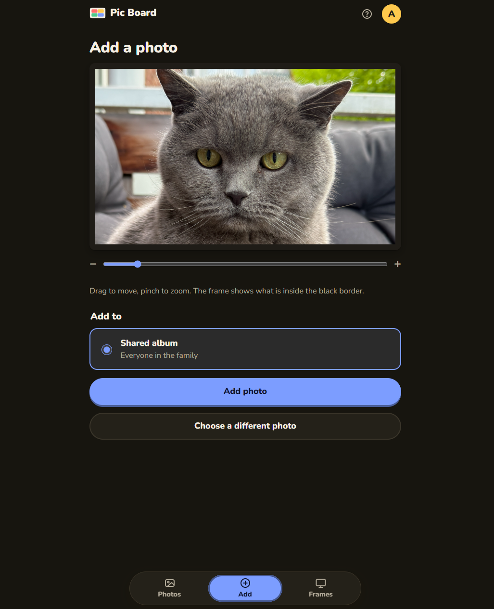
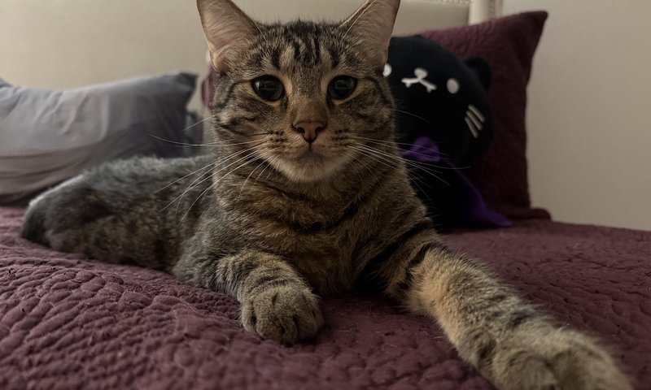
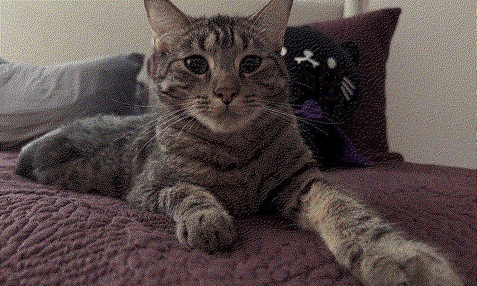

+++
title = "Pic Board"
date = "2026-11-21"
draft = true
tags = ["esp32", "e-paper", "aws", "terraform"]
description = "E-paper photo frames that let my family share photos with each other."
readingTime = false
+++

My fiancée and I are in a long-distance relationship. We have a place together, but unfortunately, I can't always be there. We're constantly sending each other photos of little things throughout the day, and I thought it would be nice to have a way to share those moments outside of our phones.

That's where the idea for Pic Board came from. I wanted to build a digital picture frame for our apartment that I could send photos to, no matter where I was. She wouldn't need to open an app or check her phone. The photo would just be there the next time she looked at the frame.

While working on it, I started thinking about how nice it would be if my parents, brother, and grandparents had one too. We could all share little moments from our lives without having to keep up with another group chat.

What started as a small project for my fiancée turned into something I wanted to build for my entire family.


I'm using the [Seeed reTerminal E1002](https://www.seeedstudio.com/reTerminal-E1002-p-6533.html) for the frames. It has an e-paper display and a battery, which makes it a good fit for something I want to leave sitting on a desk or hanging on a wall. The display only needs power to change the image, so the device can spend most of its time asleep.

The display supports six colors: black, white, red, green, blue, and yellow. Refreshing it takes somewhere between 15 and 30 seconds. It's obviously not going to look as good as a photo on your phone, but I really like how photos look on e-paper.

## How it works

I built a small web app where you can upload a photo from your phone and crop it to fit the display. The backend handles all the image processing so the frame doesn't have to do it itself.



Since the display only supports six colors, I use Pillow and Floyd-Steinberg dithering to convert the photos. This helps preserve some of the detail and shading that would otherwise be lost when reducing the image to such a limited color palette.

```python
def to_codes(img: Image.Image) -> list[int]:
    """Cover-crop to 800x480, Floyd-Steinberg dither to the 6 inks, return one code per pixel."""
    img = ImageOps.fit(ImageOps.exif_transpose(img).convert("RGB"), (W, H), Image.LANCZOS)
    pal = Image.new("P", (1, 1))
    flat = [c for rgb, _ in PALETTE for c in rgb]
    pal.putpalette(flat + flat[:3] * (256 - len(PALETTE)))
    idx = img.quantize(palette=pal, dither=Image.Dither.FLOYDSTEINBERG)
    return [PALETTE[i][1] for i in idx.get_flattened_data()]
```

Here's what that looks like with a photo of my cat, Cosmo. On the left is the original, cropped to 800x480, and on the right is the exact bitmap the frame receives.

<div class="compare">
  <figure>
    
    <figcaption>Original</figcaption>
  </figure>
  <figure>
    
    <figcaption>Six-color dither</figcaption>
  </figure>
</div>

Each frame wakes up roughly once an hour to check for new photos. If there's nothing new, it goes back to sleep. Each frame also has its own schedule, timezone, and quiet hours. Since my family lives in different places, I wanted everyone to be able to control when their frame updates.

Pressing the green button on the device wakes it up and moves to the next photo. I also store the last 20 photos locally so the frame is still usable if it loses its Wi-Fi connection.

## Albums

Each household gets its own private album, and there's a shared family album that everyone can upload to. You can switch between albums from the web app, and each frame keeps track of its own position in the album.

I can manage the frames and the shared album, but I don't have access to anyone's private albums. Even though I'm the one running everything, I wanted everyone to have some privacy.

## Why I went serverless

I didn't want to maintain a server for a couple of picture frames. I could have easily put the backend on a small VM, but I'd rather not have another machine to patch and monitor.

Instead, I built everything on AWS using serverless services. It's probably overkill for a project this small, and it introduces more moving parts than a traditional backend would, but part of the reason I build personal projects is to learn things I don't get to work with every day.

Most of my work as a DevOps engineer involves running containers on ECS and managing the infrastructure around services that use things like SNS, queues, and RabbitMQ. I spend a lot of time making sure other people's applications run properly, but I don't always get the opportunity to write the applications themselves.

With this project, I wanted to build an event-driven application from start to finish. I got to spend more time working directly with API Gateway and learn Cognito, which we don't use at work. It's one thing to provision these services with Terraform and another to build an application that actually uses them.

I could have had AI write the Lambda functions for me, but I wanted to understand how everything fit together. I enjoy working with AWS, and having something my family will actually use gives me a good reason to keep learning.

## Infrastructure



The backend is written in Python and runs on ARM64 Lambda functions behind an API Gateway HTTP API. I use DynamoDB in on-demand mode, private S3 buckets for storage, Cognito for authentication, and CloudFront to serve the web app.

Everything is managed with Terraform, and the whole thing costs me less than $2 a month to run.

I took a similar approach with my [Abfahrt Board](/posts/abfahrt-board/) project. I try to keep the firmware as simple as possible and let the backend handle most of the work.

## Setting up a frame

Both of my frames run the same firmware, without any credentials specific to the household baked into it.

When you first turn on a frame, it creates its own Wi-Fi network. You connect to it from your phone, select your home network, and enter your Wi-Fi details. The frame then displays a short pairing code that you enter in the web app to link it to your account.

Once that's done, there's nothing else I need to configure on the device.

## Firmware updates

The frames check for firmware updates whenever they wake up. They verify that an update comes from me before installing it, and if something goes wrong with the new firmware, they automatically roll back to the previous version.

Since these frames are going to be in different homes, I wanted to be able to update them remotely without asking someone in my family to plug one into a computer and flash it for me.

## Final thoughts

My favorite part of this project is being able to take a photo, upload it, and know that it'll show up on a frame in my parents' house or my fiancée's apartment the next time it checks in.

The photos don't always come out perfectly with only six colors, but there's something nice about having them displayed on e-paper. It looks more like a printed photograph than another screen in the house.

I'm happy with how it turned out, and I'm looking forward to getting more of them into my family's homes.
